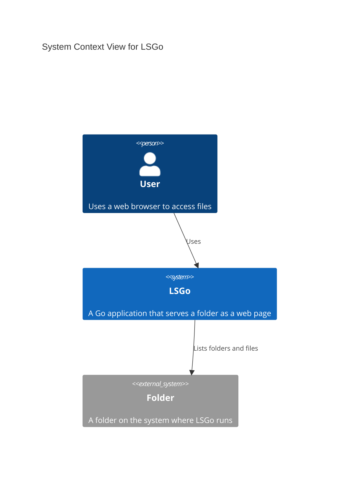
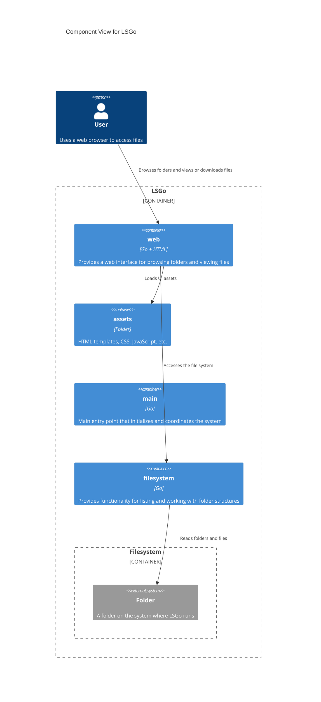
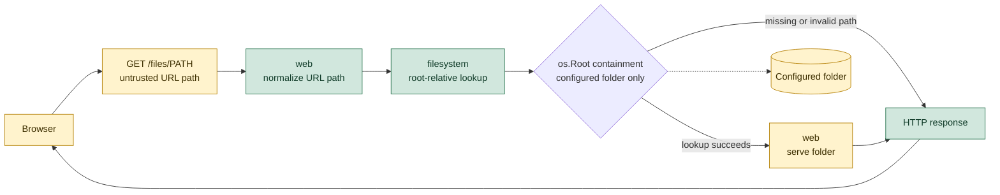
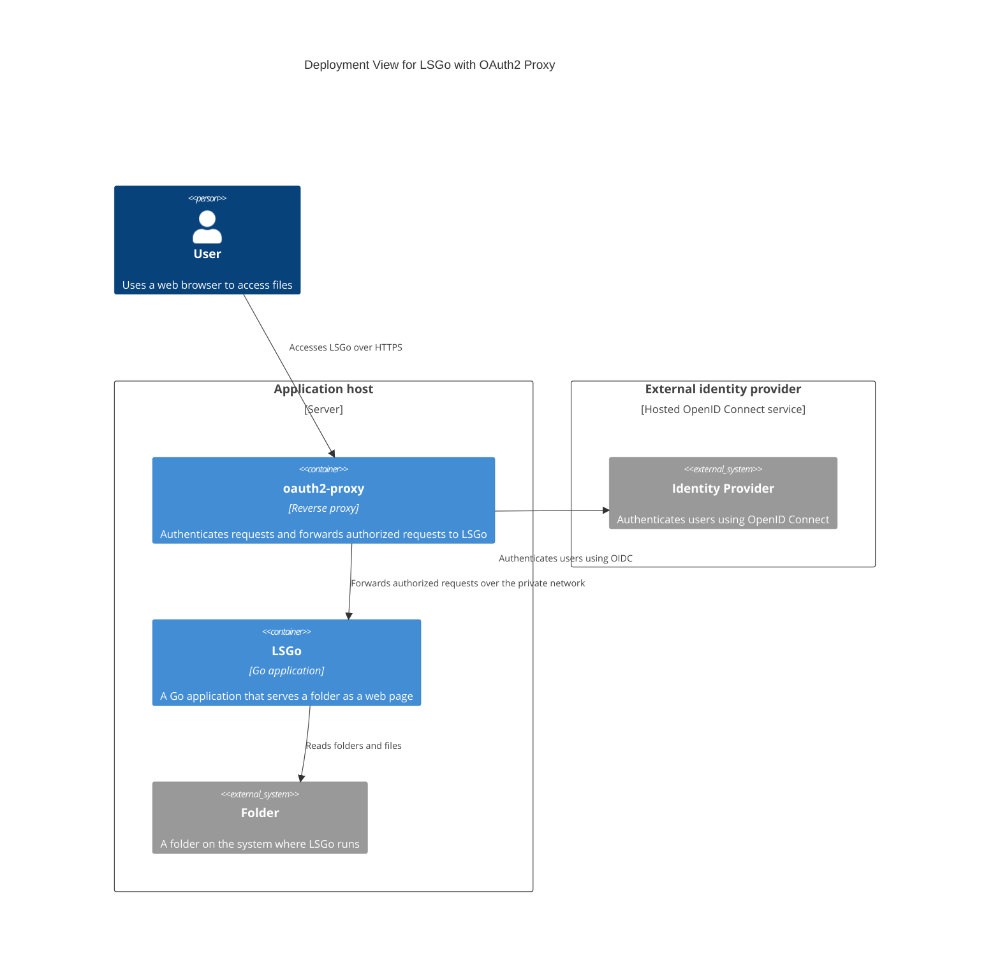

# 1. Context & Scope

# 2. Building Block View 

## 3. Runtime View

# 4. Deployment View 

# 5. Architecture Decisions (ADRs)

The project keeps its ADRs under [docs/decisions](./decisions).

# 6. Risks and Technical Debt

Priority is rated Low / Medium / High.

| What                  | Type | Priority | Description                                                                                                   |
| :-------------------- | :--- | :------- | :------------------------------------------------------------------------------------------------------------ |
| `go-rod` is abandoned | Debt | Low      | Only used for the e2e tests for Browser tests.                                                                |
| GO-2026-5932          | Risk | Low      | `golang.org/x/crypto` is used by testcontainers. Only used for the e2e tests to manage the Docker containers. |